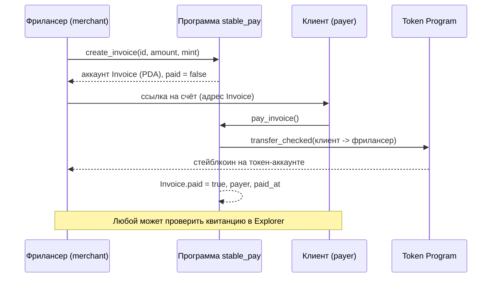

# Неделя 13: RWA, Stablecoins и платежи

**Задание:** спроектировать реальный blockchain-продукт: RWA, stablecoin payment, tokenized asset
или cross-border payment.

## Продукт: Stablecoin Invoices для фрилансеров

**Проблема.** Фрилансер из одной страны получает оплату от клиента из другой. Банковский
перевод через границу занимает дни, комиссии заметные, курс конвертации непрозрачный, а
подтвердить, что платёж за конкретную работу получен, приходится вручную.

**Идея.** Фрилансер выставляет **счёт (invoice) на сумму в стейблкоине** (например USDC).
Клиент оплачивает его одним нажатием со своего кошелька. Деньги приходят фрилансеру за
секунды, а счёт на блокчейне становится публичной проверяемой квитанцией: кто заплатил,
сколько, каким токеном и когда.

| Кто | Что получает |
|---|---|
| Фрилансер (merchant) | Быстрое получение денег в стабильной валюте, готовая квитанция |
| Клиент (payer) | Простая оплата, подтверждение платежа, не нужен банковский перевод |

## Как это работает



## Прототип (что реализовано)

Программа `programs/stable_pay/src/lib.rs`:

| Инструкция | Что делает |
|---|---|
| `create_invoice(invoice_id, amount)` | Фрилансер создаёт счёт (PDA `["invoice", merchant, id]`) на сумму в выбранном токене |
| `pay_invoice()` | Клиент платит: токены уходят напрямую на токен-аккаунт фрилансера (CPI в Token Program), счёт помечается оплаченным |
| `cancel_invoice()` | Фрилансер отменяет неоплаченный счёт и возвращает rent |

Защита:
- Токен платежа фиксирован в счёте (`address = invoice.mint`), подменить на другой нельзя.
- Токен-аккаунты проверяются на mint и владельца: деньги можно отправить только на аккаунт фрилансера.
- Платёж подписывает сам клиент (`Signer`), счёт нельзя оплатить дважды (`AlreadyPaid`).
- Оплаченный счёт нельзя отменить.
- `transfer_checked` дополнительно проверяет число знаков токена.

Тесты: `tests/stable_pay.ts` (создание счёта, оплата, повторная оплата, отмена).

## Почему Solana

- Комиссия за транзакцию составляет доли цента, а подтверждение занимает секунды.
- Стейблкоины (например USDC) существуют в сети как обычные SPL-токены, их не нужно выпускать самому.
- Квитанция в виде аккаунта читается любым приложением через RPC (как в Dashboard из недели 10).

## Что пока не реализовано (дорожная карта)

1. Web-интерфейс: страница «Создать счёт» и страница оплаты по ссылке (на основе клиента из `web/`).
2. Escrow: деньги блокируются в программе до подтверждения работы, возможен возврат или спор.
3. Частичные оплаты и подписки (повторяющиеся счета).
4. Вывод в местную валюту через партнёров (on/off-ramp).
5. Уведомления о платеже (чтение события `InvoicePaid`).

## Риски и ограничения

| Риск | Комментарий |
|---|---|
| Регулирование | Правила для криптоплатежей, налоги и отчётность зависят от страны, это нужно проверить до запуска (это не юридическая консультация) |
| Курс и надёжность стейблкоина | Эмитент может потерять обеспечение (depeg), в продукте стоит поддерживать только проверенные токены |
| Конфиденциальность | Все платежи публичны: адрес и сумма видны любому, нужно предупреждать пользователей |
| Ошибки пользователя | Платёж на неверный адрес необратим, поэтому оплата идёт по адресу счёта, а не по ручному вводу |
| Безопасность кода | Перед использованием с реальными деньгами нужен независимый аудит (в Week 12 видно, как одна пропущенная проверка опустошает программу) |

## Метрики успеха продукта

- Время от нажатия «Оплатить» до получения денег.
- Доля оплаченных счетов от выставленных.
- Средняя комиссия на платёж по сравнению с банковским переводом.

## Как запустить

```bash
anchor build
anchor keys sync
anchor deploy
npm install
anchor test --provider.cluster devnet tests/stable_pay.ts
```

## Что сдавать

- Ссылка на этот коммит.
- Этот документ (описание продукта, архитектура, риски).
- Скриншот тестов или транзакции `pay_invoice` в Solana Explorer (cluster=devnet).

## Честная заметка о проверке

Код не компилировался и тесты не запускались в среде, где он писался (не было доступа к
npm и cargo). Запусти `anchor test` у себя; если появится ошибка, пришли её текст.
